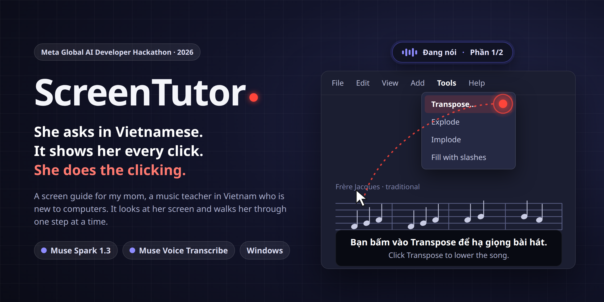
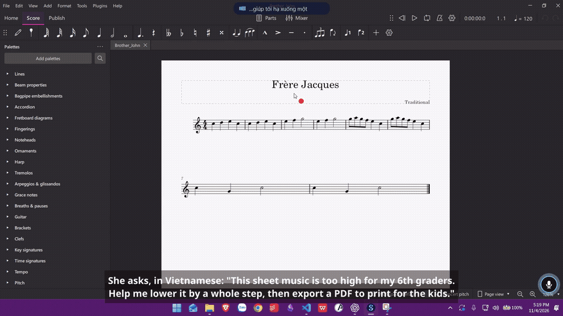

<p align="center"></p>

<p align="center">


</p>

<p align="center">
<a href="https://youtu.be/jDSKgcugi4U"><b>Demo video</b></a> ·
<a href="https://x.com/thanath1839/status/2118137790831501663"><b>Post on X</b></a> ·
<a href="#what-it-does"><b>What it does</b></a> ·
<a href="#how-it-works"><b>How it works</b></a> ·
<a href="#run-it"><b>Run it</b></a> ·
<a href="docs/README.vi.md"><b>Tiếng Việt</b></a>
</p>

# ScreenTutor

**A voice-guided agent for Windows that watches the screen, points at one thing at a time and checks every step, so an older teacher who is new to computers can finish her own tasks. It never clicks for her.**

Built for the Meta Global AI Developer Hackathon (26 Oct – 4 Nov 2026) on two Meta models: **Muse Spark 1.3** and **Muse Voice Transcribe**.

<p align="center">
<a href="https://youtu.be/jDSKgcugi4U"></a>
<a href="https://x.com/thanath1839/status/2118137790831501663"></a>
</p>

<p align="center"></p>
<p align="center"><sub>Real screen recording on Windows 11, 4 Nov 2026, taken from the demo video. The wait for the model is sped up 8× (marked on screen); the tutor's voice and her clicks play at normal speed.</sub></p>

## At a glance

- **Who it is for.** My mother, a Vietnamese teacher who is new to computers. Her work now runs through Zalo, Word, Google Sheets and a browser, and small things stop her: the lesson plan she edited "is gone" because she opened a temporary copy, or a link "did not open" because the page came up behind another window.
- **What it does.** She asks out loud, in Vietnamese. ScreenTutor looks at her screen, says one step, and puts a dot on the one thing to click. **She does the clicking; it never clicks or types.** When the screen settles, it checks whether the step worked and shows the next one, until the task is done.
- **How Meta's models power it.** **Muse Voice Transcribe** hears her question in real time. **Muse Spark 1.3** reads the screenshot together with a short summary of Windows state, decides where to point and what to say, plans tasks that take several parts, and after each click checks whether the step and the task are done.
- **Try it.** Windows 10/11, Python 3.10+, a microphone and a Meta Model API key. See [Run it](#run-it).

## The problem

Her questions show where she gets stuck. Eight of them were recorded in her own voice:

- **"The lesson plan I edited yesterday is gone."** A file can exist in several copies, and the one she opens may not hold her edits. One route, confirmed on a machine set up like hers: a file clicked straight in Zalo opens as a *read-only temporary copy* in `AppData\Local\Temp\Zalo Temp\TempDownloads`, so her edits never reach the real file.
- **"I clicked the link and nothing opened."** The Google Sheet did open, in a browser window hidden behind Zalo.
- She needs to send the print shop a PDF, a file name is "not valid", or she has to add a row to a table.

Each of these is a few clicks for someone who knows where to click, and a dead end for her. Doing it for her solves today's problem; showing her, one step at a time, means she can do it again tomorrow.

## What it does

1. **She asks in her own words.** She presses the round microphone button, or holds **Ctrl+Alt**, and speaks Vietnamese. She can point at something with the mouse, or circle it, and say "this one".
2. **It reads the screen and the machine.** Along with the screenshot, the tutor gets a short **Windows state summary**: what a screenshot cannot show, such as which window is behind which, the default apps, the real folders and the newest files.
3. **It shows one step at a time.** A calm Vietnamese voice says what to do and why, and the mark moves as the voice starts:
   - a **red dot** that waits beside her mouse while the tutor looks, then flies to the one thing to click;
   - an **amber dot** when the click will send something or replace a file;
   - a **frame** around what to read, with the rest of the screen dimmed;
   - a **small mouse with a turning wheel** where to scroll;
   - keyboard shortcuts shown as keys, such as **[Ctrl] + [A]**.
4. **She acts, and it checks.** The tutor waits until the screen settles, checks whether the step worked, shows a **green tick** where she clicked, and points at the next step.
5. **It plans tasks with several parts.** The plan appears on a dynamic island at the top of the screen, and the tutor moves from part to part without being asked again. When the instructions sit in a long chat message, it has her scroll to the end and builds the plan from the message itself.
6. **It keeps up with her.** Just before it speaks, it compares a fresh screenshot with the one its answer was based on. If she has already clicked ahead, or a box has opened, it stays quiet and looks again.
7. **It speaks up about a known trap.** When Word is showing Zalo's temporary copy, the tutor says so once, from signals on the machine alone, and leads her to the real file if she asks.
8. **It remembers her work.** After each task, a short note goes into a knowledge base on her machine, searched locally, so "send this to the print shop like last time" can mean something.
9. **It stops when she says so.** A short "stop" or "later", or the × on the island, ends the task on the machine without calling the model.

The aim is that she finishes the task herself, and learns the route on the way.

## How it works

<p align="center"></p>
<p align="center"><sub>Illustration in the app's colours. The banner at the top is an illustration too; the GIF above is a real recording.</sub></p>

### How the Meta models are used

| Model | Role in ScreenTutor | Why this one |
|---|---|---|
| **Muse Spark 1.3**: image understanding, a JSON answer on a 0–1000 grid, streamed, `reasoning_effort: "minimal"` | One call returns where to point, what to say, what kind of step it is, the box to read, the plan and the notes. After she acts, a follow-up call decides whether the step and the task are done and what comes next. A third, text-only call turns each finished task into a note for her knowledge base. | Compared with Muse Wonder on labelled real screenshots of the apps she uses, it pointed more accurately and answered faster. |
| **Muse Voice Transcribe**: realtime WebSocket | The round button uses ENDPOINTING, so the model hears when she stops talking. **Ctrl+Alt** uses PUSH_TO_TALK. Both add a Vietnamese bias plus app and family keywords, and short pauses are joined into one turn. | Her own recorded questions kept their meaning once the bias, the keywords and turn joining were in place. |

**Streaming the structured answer.** The API writes JSON keys in sorted order whatever the schema says, and capitals sort first. So the keys that place the step are named `Box, Caution, Goal_done, Step_done, Target, X, Y`, followed by `say` and the rest, with the `task_*` fields last. The place is known as soon as `Y` is complete and the voice can start as soon as `say` is, while the plan and the notes are still arriving. The dot flies when the first sound plays, so she hears and sees the step together.

**What runs on her machine.** Only Standard-tier models are used, never Contributor variants. The Meta API has no text-to-speech and no embedding model, so the voice is **VieNeu-TTS v3 Turbo** (Apache-2.0), running locally on the CPU (int8), and the knowledge base is searched with BM25 on her machine.

<details>
<summary><b>The whole loop, as a diagram</b></summary>


</details>

## Privacy and safety

- **It never clicks or types.** She is always the one who acts. Clicks are only *observed*, by polling the button state; no global hook is installed.
- **Nothing is sent until she asks**, with the round button or Ctrl+Alt. Her voice then goes to Muse Voice Transcribe. During a task she started, each step sends Muse Spark a screenshot and the state summary, which includes window titles and recent file names. The tutor's voice is generated on the machine.
- **Mouse pointing** is worked out on the machine and sent as one line of coordinates, never as a picture.
- **The guard for Zalo's temporary copy** reads the window in front and the names in one folder. It takes no screenshot and sends nothing.
- **After a task, its words go to Muse Spark** to be summarised, with no picture, and a new question can carry short notes from similar past tasks. A filter on the machine first removes passwords, phone numbers, e-mail addresses and full names. It does not catch everything, and it does not touch screenshots.
- **What stays on her machine:** screenshots of each step (`tutor_runs/`), her tasks (`history/`) and her knowledge base (`history/memory/`), all gitignored. A button on the island deletes the history and the knowledge base. Apart from the short MuseScore GIF above, no real screenshots, recordings or raw API answers are stored in this repository.
- The model is told to flag a click that **sends or replaces** something, so the dot turns amber and the sentence says what will happen.

## Run it

Windows 10/11 with Python 3.10+, a microphone, speakers and a Meta Model API key. In PowerShell, from the repository folder:

```powershell
py -m pip install -r requirements.txt
Copy-Item .env.example .env
# In Notepad, put your key after MODEL_API_KEY= and save
notepad .env
.\ScreenTutor.bat
```

`ScreenTutor.bat` starts `py -m screentutor.app` in a minimised window (double-clicking it works too; closing that window closes ScreenTutor). The first start downloads the voice model (about 250 MB). Then press the round microphone button, or hold **Ctrl+Alt**, and ask.

Development also runs on Linux: every Windows part sits behind a small, testable interface.

```bash
python -m pytest -q    # 300+ tests, no network
```

## Repository map

| Path | What it is |
|---|---|
| `screentutor/app.py` | The app: button, hotkey, listening, session, overlay, island, voice, guards, memory |
| `screentutor/tutor.py` | The Muse Spark calls: first turn (`ask`), step check (`follow_up`), task note (`summarise`), and the streaming reader |
| `screentutor/session.py` | The agent loop: plan and parts; click, drag, shortcut, typing, read, scroll and wait steps; picking a task up again. Each step is shown with the first sound of its sentence |
| `screentutor/fresh.py` | Before a step is spoken, checks that the screen is still the one it is about |
| `screentutor/island.py`, `conversation.py`, `ui.py` | The dynamic island, its talk and its 12 states; the round button |
| `screentutor/overlay.py` | Click-through overlay: the dot that waits beside her mouse and flies to the target, reading frame, scroll hint, tick, edge light |
| `screentutor/guards.py` | Speaking up without being asked: Zalo's temporary copy |
| `screentutor/memory.py`, `history.py` | Her knowledge base (BM25, profile, privacy filter) and stop requests; her tasks, one file each |
| `screentutor/gesture.py` | What her mouse path says: stopped at a point, or circled a region |
| `screentutor/listen.py`, `levels.py` | Muse Voice Transcribe realtime client with turn joining; sound levels for the island |
| `screentutor/state.py`, `winstate.py` | Windows state sensors (ctypes, no extra dependencies) |
| `screentutor/inputs.py`, `still.py` | Observing clicks, drags, nine shortcut keys (never what she types) and the mouse path; waiting for a still screen or a change |
| `screentutor/textsnap.py` | Moves a drag's two ends to word edges, so a selection never cuts a word |
| `screentutor/speak.py` | Local VieNeu voice, with fixes for how file names and times are read; reports when its first sound goes out |
| `grounding_test/`, `tutor_eval/`, `stt_eval/`, `tts_eval/` | Evaluation harnesses used during development to choose models, prompts and settings |

## Roadmap

- A guard that holds back Enter, Tab and Delete while a whole document is selected, so edits to a whole document are safe.
- Picking the big task back up straight from the island's "Continue" button after a side question.
- Sessions with her on her own tasks, to see whether she needs less help each time.
- More apps, screen setups and languages.

## Built during the hackathon

Everything in this repository was written during the event: the first commit is 27 Oct 2026, and the work runs from 28 Oct to 4 Nov 2026. The commit history shows each step. ScreenTutor did not exist before the hackathon.

Not ours, used as-is through their public packages or APIs:

- Meta's Muse Spark 1.3 and Muse Voice Transcribe, through the Meta Model API.
- VieNeu-TTS v3 Turbo, a Vietnamese voice model under Apache-2.0, run locally.
- Qt for Python (PySide6, LGPL), Pillow, httpx, websockets and sounddevice.

The demo uses MuseScore 4 as an ordinary app, with the traditional melody *Frère Jacques*. ScreenTutor has no code specific to MuseScore.

The invented Zalo window in `tutor_eval/fake_zalo.py` is drawn for testing and is not connected to Zalo in any way. HeyClicky, an existing screen tutor, was only *used*, as a user, for a side-by-side comparison (`docs/heyclicky_comparison/`); none of its code is used. The Word file under `docs/heyclicky_comparison/test_files/` is a made-up test document.

## License

MIT, see [LICENSE](LICENSE).
