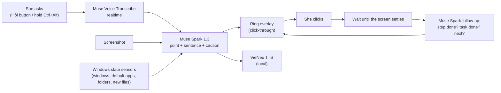

# ScreenTutor

**A voice tutor for Windows that points at the screen, so an older teacher who is new to computers can finish today's task herself and remember how next time.**

Built for the Meta Global AI Developer Hackathon on two Meta models: **Muse Spark 1.3** sees the screen and decides each step, and **Muse Voice Transcribe** hears her questions in Vietnamese.

*Tiếng Việt: [docs/README.vi.md](docs/README.vi.md)*

---

## The problem

The person this is built for is a Vietnamese teacher. Her work now runs through Zalo, Word, Google Sheets and a browser, and she is new to computers. We recorded eight questions she really asked, in her own voice. They show where she gets stuck:

- **"The lesson plan I edited yesterday is gone."** Her file can exist in several copies, and the one she opens may not hold her edits. Several routes lead there. One we confirmed on a machine set up identically to hers: a file clicked straight in Zalo opens as a *read-only temporary copy* in `AppData\Local\Temp\Zalo Temp\TempDownloads`, so edits made there never reach the real file. Which route she hits most often is not known yet.
- **"I clicked the link and nothing opened."** The Sheet did open, but in a browser window hidden behind Zalo.
- She needs to send the print shop a PDF, a file name is "not valid", or she must add a row to a table.

Each of these is a few clicks for someone who knows where to click, and a dead end for her.

## What it does

1. She presses the **"Hỏi" (Ask)** button, or holds **Ctrl+Alt**, and asks in her own words.
2. The tutor looks at the screen together with a short **Windows state summary**. The summary covers things a screenshot cannot show: which window is behind which, the default apps, the real folders and the newest files.
3. A **red ring glides to the one thing to click**, and a calm Vietnamese voice says what to do and why.
4. **She clicks.** The tutor never clicks or types for her. It waits until the screen has settled, checks whether the step worked, and then points at the next step, until it can say the task is done.
5. If a click would **send something or replace a file**, the model is told to warn first: the ring turns **amber** and the voice says what will happen. This has not been checked yet on a real send or overwrite (see Limitations).

The aim is that she finishes the task herself, so she also learns the route.

## How the Meta models are used

| Model | Role in ScreenTutor | Why this one (measured, see below) |
|---|---|---|
| **Muse Spark 1.3**, image understanding, JSON answer on a 0–1000 grid, `reasoning_effort: "low"` | One call returns the point to show, the sentence to say, and a `caution` flag. After each click, a follow-up call decides whether the step is done, whether the task is done, and what comes next. | Best trade-off on 12 labelled real screenshots: 10/12 hits per run. `effort low` kept the accuracy and cut the median from 4.6 s to 2.4 s. Muse Wonder hit 9/12, was slower (median 7.9 s), and rejects the computer-use tool. |
| **Muse Voice Transcribe**, realtime WebSocket | The **Hỏi** button uses ENDPOINTING, so the model hears when she stops. **Ctrl+Alt** uses PUSH_TO_TALK. Both use a Vietnamese bias plus app and family keywords. | Her 8 real questions kept their meaning 8/8 once turns are joined (see T7a). |

Only Standard-tier models are used, never Contributor variants. The Meta API has no text-to-speech, so the voice is **VieNeu-TTS v3 Turbo** (Apache-2.0), running locally on the CPU (int8). **SAM 3.1** was tried for a tight outline around the target and left out, because it failed its test (T11 below).



## Evidence

Each test's **pass rule was committed before its run**, so the rule is on record before the result. A rerun after a failure gets its own committed rule, and the history shows both. The one exception is the whole-app part of the field run (T8), which had no pass rule: it was a first look at the full loop. All runs use real screenshots from a machine set up like hers, or her real recorded voice.

| Test | What it checks | Result |
|---|---|---|
| Grounding stage 1 | Where to click, on 12 labelled real screenshots | Spark M2: 10/12 per run; median 4.6 s, or **2.4 s at effort low** |
| T1 | Does a text summary of Windows state fix what a screenshot cannot show? | The "link opened behind Zalo" case went **0/2 → 2/2**; the other 8 controls stayed 8/8 |
| T3 | Her 8 real voice questions, transcribed | **8/8** kept their meaning with the Vietnamese bias and keywords |
| T7a | Her recordings through realtime ENDPOINTING | Without joining, 3/8 questions were cut at a pause. **Joining turns within 1.0 s: 8/8.** Push-to-talk: 8/8, text 0.15 s after release |
| TTS | VieNeu int8 vs fp32 intelligibility (ASR round trip), and speed | Syllable error 8.2% vs 7.4%. On Windows: **first audio 0.15 s**, RTF 0.29 |
| T4 | One Spark call both points and writes the spoken sentence | Latest run: **11/12 and 12/12**, 24/24 sentences pass the checks, median 4.9 s, p90 9.3 s |
| T6a | After a click, is the step or the task done, and what is next? (12 before/after pairs) | Step done 24/24, task done 22/24, next point 16/18 |
| T8b | Her real voice → hearing → Spark → voice, end to end | 4 recordings × 2 runs: **8/8 pointed right**, up from 4/8 on the same recordings after a note about the WPS button was added, so this is not a fresh sample. 7.5 s median from the end of her speech to the tutor's first word |
| T11 | Can SAM 3.1 turn Spark's point into a tight outline? (24 points from T4) | **Failed:** 15/21 outlines right against a 90% rule, and worse by eye. Speed passed (0.85 s). SAM stays out of the app and the plain ring stays |
| Windows field run (T5–T8) | Whole app on a machine set up like hers, the builder playing her role | Ring on the mouse tip 5/5 at 125% scaling. Clicks and typing pass through. **PDF export done in 6 guided steps**. In one "blank copy" run the tutor led to the right copy via File › Info › Open file location |

The field run also found these problems. Fixes are in the code:

- The session stopped while a page was still loading.
- There was no warning before replacing a file.
- The tutor pointed at a WPS "Create PDF" button that only asks to install WPS.
- The transcript pill blocked clicks.

T8b confirms the WPS fix, and T4 and T6a show the changes did not hurt pointing. The other three fixes only show on a real Windows desktop, and that rerun (`docs/tests/T9_FIXES_WINDOWS.txt`) is still to come.

## Privacy and safety

- **It never clicks or types.** She is always the one who acts. Clicks are only *observed*, by polling the button state; no global hook is installed.
- **Nothing is sent until she asks**, with the Hỏi button or Ctrl+Alt. Her voice then goes to Muse Voice Transcribe. During a task she started, each step sends Muse Spark a screenshot and the state summary, which includes window titles and recent file names. The tutor's voice is generated on the machine.
- Each step's screenshot is also saved **on her machine** (`tutor_runs/`, gitignored), for debugging. Real screenshots, recordings and raw API answers are not stored in this repo's branches.
- The model is told to flag a click that **sends or replaces** something, so the ring shows amber and the voice says so first. See Limitations.

## Run it

Windows 10/11 with Python 3.10+, a microphone and speakers:

```bash
py -m pip install -r requirements.txt
copy .env.example .env      # then put your MODEL_API_KEY in .env
ScreenTutor.bat             # or: py -m screentutor.app
```

The first start downloads the voice model (about 250 MB).

Development and tests also run on Linux. All the Windows parts sit behind small, testable interfaces:

```bash
python -m pytest -q                         # 80+ tests, no network
```

The paid tests need the labelled screenshots and her recordings, which stay private, so they do not run from a fresh clone. Their raw results stay private too, because they hold real screens:

```bash
python -m tutor_eval.run run --yes          # T4 (about $0.17)
python -m tutor_eval.steps run --yes        # T6a
python -m tutor_eval.e2e run                # T8b
python -m tutor_eval.sam run --yes          # T11 (about $0.06)
```

## Repository map

| Path | What it is |
|---|---|
| `screentutor/app.py` | The whole app: button, hotkey, listening, session loop, ring and voice |
| `screentutor/tutor.py` | The Muse Spark calls: first turn (`ask`) and the step check (`follow_up`) |
| `screentutor/listen.py` | Muse Voice Transcribe realtime client, with turn joining |
| `screentutor/state.py`, `winstate.py` | Windows state sensors (ctypes, no extra dependencies) |
| `screentutor/overlay.py`, `ui.py` | Click-through ring; the Hỏi button and the transcript pill |
| `screentutor/inputs.py`, `still.py`, `session.py` | Observing clicks; waiting for a still screen; the step-by-step loop |
| `screentutor/speak.py` | Local VieNeu voice, with fixes for how file names and times are read |
| `grounding_test/`, `tutor_eval/`, `stt_eval/`, `tts_eval/` | The tests above, each with its pre-registered rule |
| `docs/tests/` | Checklists and results of the hands-on Windows runs. T2–T8 are filled in; T9 is the next run. T10, her own trial, is not planned before the deadline |

## Built during the hackathon

Everything in this repository was written during the event: the first commit is 27 Oct 2026, and the work runs from 28 Oct to 4 Nov 2026. The commit history shows each step and each test rule, committed before its run. ScreenTutor did not exist before the hackathon.

Not ours, used as-is through their public packages or APIs:

- Meta's Muse Spark 1.3 and Muse Voice Transcribe, through the Meta Model API.
- VieNeu-TTS v3 Turbo, a Vietnamese voice model under Apache-2.0, run locally.
- Qt for Python (PySide6, LGPL), Pillow, httpx, websockets and sounddevice.

HeyClicky, an existing screen tutor, was only *used* as a user, for a side-by-side comparison (`docs/heyclicky_comparison/`). None of its code is used.

The Word file under `docs/heyclicky_comparison/test_files/` is a made-up test document.

## Limitations

- **Latency.** About 7.5 s from the end of her question to the first word; most of it is Spark's reasoning. The status pill shows what the tutor is doing in the meantime.
- **Start menu.** Windows draws the Start menu above every normal window, so it can hide the ring.
- **Amber warning unproven.** It raised no false alarm in 56 offline calls, but it has never been tried on a real send or overwrite.
- **Still-screen check.** It passed 4 of 6 situations in the field run, below its rule of 5 of 6. It did not report a still screen early while Word or a Sheet was opening.
- **Tested on one machine, set up like hers:** 1920×1080 at 125%, English UI, Zalo, Word and Brave. Two facts about this machine are written into the prompt (the WPS button and Zalo's temporary copies). Other setups have not been tested.
- **Learning is not measured.** The aim is that she needs less help next time, and no test shows that yet.

## License

MIT, see [LICENSE](LICENSE).
