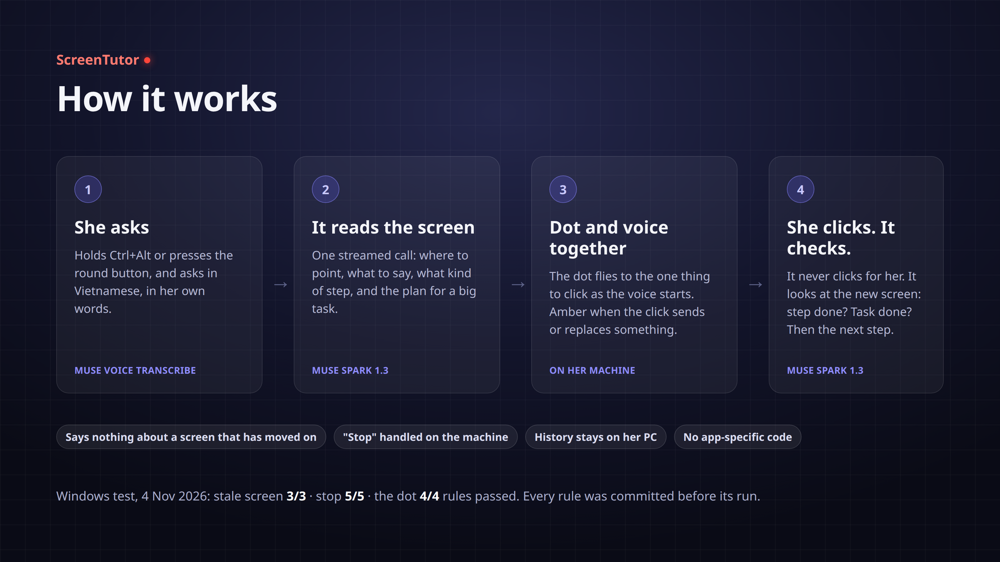
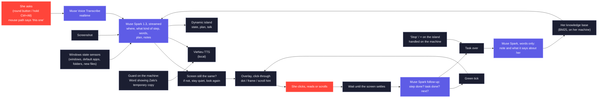

<p align="center"></p>

<p align="center">


</p>

<p align="center">
<a href="#how-it-works"><b>How it works</b></a> ·
<a href="#evidence"><b>Evidence</b></a> ·
<a href="#run-it"><b>Run it</b></a> ·
<a href="#limitations"><b>Limitations</b></a> ·
<a href="docs/README.vi.md"><b>Tiếng Việt</b></a>
</p>

# ScreenTutor

**A multi-step agent for Windows that watches the screen, points at one thing at a time, and checks each step, so an older teacher who is new to computers can finish today's task herself. It never clicks for her.**

Built for the Meta Global AI Developer Hackathon on two Meta models: **Muse Spark 1.3** sees the screen, plans big tasks and checks each step, and **Muse Voice Transcribe** hears her questions in Vietnamese.

> **Tested on Windows, 4 Nov 2026** ([T15](docs/tests/T15_WINDOWS.txt), every rule committed before its run):
> it said nothing about a screen that had moved on in **3 of 3** cases built for it, stopped when told to on **5 of 5** rules, and the dot passed **4 of 4**.
> What failed is listed too, under [Limitations](#limitations).

---

## The problem

The person this is built for is a Vietnamese teacher. Her work now runs through Zalo, Word, Google Sheets and a browser, and she is new to computers. We recorded eight questions she really asked, in her own voice. They show where she gets stuck:

- **"The lesson plan I edited yesterday is gone."** Her file can exist in several copies, and the one she opens may not hold her edits. Several routes lead there. One we confirmed on a machine set up identically to hers: a file clicked straight in Zalo opens as a *read-only temporary copy* in `AppData\Local\Temp\Zalo Temp\TempDownloads`, so edits made there never reach the real file. Which route she hits most often is not known yet.
- **"I clicked the link and nothing opened."** The Sheet did open, but in a browser window hidden behind Zalo.
- She needs to send the print shop a PDF, a file name is "not valid", or she must add a row to a table.

Each of these is a few clicks for someone who knows where to click, and a dead end for her.

## What it does

1. She presses the **round microphone button**, or holds **Ctrl+Alt**, and asks in her own words. She can point at something with the mouse or circle it and say "this one".
2. The tutor looks at the screen together with a short **Windows state summary**: things a screenshot cannot show, like which window is behind which, the default apps, the real folders and the newest files.
3. A calm Vietnamese voice says what to do and why, and the mark appears **with the first sound**, not before:
   - a **red dot** that waits beside her mouse while the tutor looks, then flies to the one thing to click;
   - an **amber dot** when the click would send something or replace a file;
   - a **mint frame** around what to read, with the rest of the screen darkened;
   - a **small mouse with a turning wheel** where to scroll;
   - for a few steps, a drag to select, a shortcut shown as keys (**[Ctrl] + [C]**), or what to type into a box.
4. **She acts.** The tutor never clicks or types. It waits until the screen has settled, checks whether the step worked, shows a **green tick** where she clicked, and points at the next step until the task is done.
5. **Big tasks.** When the job is in a long message that runs past the screen, the tutor has her scroll to the end, keeps notes, and makes the plan from the message itself. The parts appear on the dynamic island at the top of the screen, and it goes on from part to part without being asked again.
6. **Side questions.** A new question gets its own task. When it is over, the island offers "Continue" (the button reads *Làm tiếp*), and the big task resumes at the part where it stopped.
7. **It speaks up when it sees a trap.** When Word is showing Zalo's temporary copy, the tutor says so once, from signals on the machine alone, and then leads her to download the real file if she asks.
8. **It learns her work.** After each task a short note goes into a knowledge base on her machine, searched locally, so "send this to the print shop like last time" can mean something.
9. **It says nothing about a screen that has moved on.** Just before it speaks, it compares a fresh screenshot with the one its answer was based on. If she has already clicked ahead, or a box has opened, it stays quiet and looks again.
10. **It stops when she says so.** A short "stop" or "later", or the × on the island, ends the task on the machine, without the model. Nothing is offered after it.

The aim is that she finishes the task herself, so she also learns the route.

## How it works

<p align="center"></p>

## How the Meta models are used

| Model | Role in ScreenTutor | Why this one (measured, see below) |
|---|---|---|
| **Muse Spark 1.3**, image understanding, JSON answer on a 0–1000 grid, streamed, `reasoning_effort: "minimal"` | One call returns where to point, what to say, what kind of step it is, the box to read, the plan and the notes. After she acts, a follow-up call decides whether the step and the task are done and what comes next. A third, words-only call turns each finished task into a note. | Best trade-off on 12 labelled real screenshots: 10/12 hits per run. Muse Wonder hit 9/12, was slower (median 7.9 s), and rejects the computer-use tool. |
| **Muse Voice Transcribe**, realtime WebSocket | The round button uses ENDPOINTING, so the model hears when she stops. **Ctrl+Alt** uses PUSH_TO_TALK. Both use a Vietnamese bias plus app and family keywords. | Her 8 real questions kept their meaning 8/8 once turns are joined (see T7a). |

**Streaming the structured answer.** The API writes JSON keys in sorted order whatever the schema says, and capitals sort first. So the keys that show the step are named `Box, Caution, Goal_done, Step_done, Target, X, Y`, then come `say` and the rest, and the `task_*` fields last. The place is known as soon as `Y` is complete and the voice starts as soon as `say` is, while the plan and the notes finish arriving. The dot flies when the first sound plays, so she hears and sees the step together.

Only Standard-tier models are used, never Contributor variants. The Meta API has no text-to-speech and no embedding model, so the voice is **VieNeu-TTS v3 Turbo** (Apache-2.0), running locally on the CPU (int8), and the knowledge base is searched with BM25 on her machine. **SAM 3.1** was tried for a tight outline around the target and left out, because it failed its test (T11 below).

<details>
<summary><b>The whole loop, as a diagram</b></summary>



</details>

## Evidence

Each test's **pass rule was committed before its run**, so the rule is on record before the result. A rerun after a failure gets its own committed rule, and the history shows both. The one exception is the whole-app part of the field run (T8), which had no pass rule: it was a first look at the full loop. The tests up to T11 and the T12 and T14 rows on the 12 cases use real screenshots from a machine set up like hers, or her real recorded voice. The rows marked *invented screens* use a drawn Zalo window where every word is made up.

| Test | What it checks | Result |
|---|---|---|
| Grounding stage 1 | Where to click, on 12 labelled real screenshots | Spark M2: 10/12 per run; median 4.6 s, or **2.4 s at effort low** |
| T1 | Does a text summary of Windows state fix what a screenshot cannot show? | The "link opened behind Zalo" case went **0/2 → 2/2**; the other 8 controls stayed 8/8 |
| T3 | Her 8 real voice questions, transcribed | **8/8** kept their meaning with the Vietnamese bias and keywords |
| T7a | Her recordings through realtime ENDPOINTING | Without joining, 3/8 questions were cut at a pause. **Joining turns within 1.0 s: 8/8.** Push-to-talk: 8/8, text 0.15 s after release |
| TTS | VieNeu int8 vs fp32 intelligibility (ASR round trip), and speed | Syllable error 8.2% vs 7.4%. On Windows: **first audio 0.15 s**, RTF 0.29 |
| T4 | One Spark call both points and writes the spoken sentence | Latest run: **11/12 and 12/12**, 24/24 sentences pass the checks, median 4.9 s, p90 9.3 s |
| T6a | After a click, is the step or the task done, and what is next? (12 before/after pairs) | Step done 24/24, task done 22/24, next point 16/18 |
| T8b | Her real voice → hearing → Spark → voice, end to end | 4 recordings × 2 runs: **8/8 pointed right**, up from 4/8 on the same recordings after a note about the WPS button was added, so this is not a fresh sample. 7.5 s median from the end of her speech to the tutor's first word |
| T11 | Can SAM 3.1 turn Spark's point into a tight outline? (24 points from T4) | **Failed:** 15/21 outlines right against a 90% rule, and worse by eye. Speed passed (0.85 s). SAM stays out of the app and the plain ring stays |
| Windows field run (T5–T8) | Whole app on a machine set up like hers, the builder playing her role. Before the island and everything below | Ring on the mouse tip 5/5 at 125% scaling. Clicks and typing pass through. **PDF export done in 6 guided steps**. In one "blank copy" run the tutor led to the right copy via File › Info › Open file location |
| T12, part (R5, R6) | Do big-task rules hurt the 12 real cases? Six runs, one void (a DNS failure on the test machine) | First run **failed**: pointing kept (12 and 10 of 12) but median 11.1 s. Last run: **11/12 and 11/12**, 24/24 sentences (a code filter for sentences about the tutor itself was in place, and changed none), median 5.35 s, **ring up at 3.15 s** (p90 5.0 s), no false caution. The link behind Zalo 5/5, after minimal effort alone had dropped it to 1/5. Not independent: the state rule was written after seeing that case |
| Big tasks, *invented screens* | Real session and real Spark, simulated user, 3 tasks × 3 runs. **Not T12** | Last run **failed its plan rule, 7/9** against 8/9: one run answered in one step with no plan. Read box 3/3 (IoU 0.99), scrolled when the message was cut 9/9, sentences 21/21. Ring up at 6.2 s, answer done at 10.6 s |
| T14 | Her knowledge base on 40 made-up tasks and 15 questions; filter on 20 samples | Right task in top 3 **9/10**, nothing wrongly found 5/5, filter 20/20, 12/12 ordinary sentences unharmed, search 0.2 ms. With the block in the prompt, pointing held at 11/12 twice. **It did not make answers faster:** 6.62 s against 5.35 s in one run each |
| Memory A/B, *invented screens* | "Send this to the print shop like last time", no chat says print shop | With what it remembers **5/5** on the right chat, without it **0/5**. A case built to show this, not a rate |
| Picking a task up again, *invented screens* | Part 2 of 6, she did something else, says "carry on" | Stays on part 2, no new plan, a ring back to the right window: **5/5** on each rule, on the second run; the first found no ring in 2 of 5 calls |

The field run also found problems that are fixed in the code: the session stopped while a page was loading, there was no warning before replacing a file, the tutor pointed at a WPS button that only asks to install WPS, and the transcript pill blocked clicks. T8b confirms the WPS fix. T13 (3 Nov) ran the island, big tasks and memory on Windows for the first time; what it found led to the changes in T15.

### T15: the Windows run of 4 Nov

The builder played her role on the Windows machine, with screen recordings and the console of every step. Each rule was written in `docs/tests/T15_WINDOWS.txt` before the run, and the results are filled in there. Recordings stay private: they show real chat names.

| Part | Rule | Result |
|---|---|---|
| Voice and pointing together (C1) | Median voice-after-mark ≤ 0.5 s; none above 1.0 s; none with the mark more than 0.5 s after the voice; none with a mark and no voice | 3 of 4 rules pass. **The third fails as measured:** 2 turns with the mark 1.9 s and 1.0 s after the voice. Frame by frame, both are measuring errors: the dot takes off at 36.0 s and lands at 36.25 s against a voice at 36.1 s, and lands at 25.75 s against 25.6 s. The script was written for the old ring and finds the small dot in only 3 of 10 spoken turns. The rule stays failed |
| Stale screen (C2) | No sentence about something gone, in 3 cases built for it (a toast that closes, clicking ahead, a box that opens); at most one false alarm per normal task | **Pass, 3 of 3**, no false alarm. Looking again costs 6–15 s of silence |
| The dot beside the mouse (C4) | Not in any screenshot sent to the model (19 checked); seen flying in the recordings; Python CPU ≤ 1.5% while she moves the mouse; mouse movement not taken for a changing screen | **Pass, 4 of 4** (CPU 1.5%, at the limit). It covers the word it lands on |
| Dragging, shortcuts, typing (K) | Open a plain-text web address from a chat without being told to click it; Ctrl+A then a font size of 15 | **Failed, both.** See Limitations |
| "Continue" after a side question (W-6) | Offered once after a one-turn answer; a click goes back to the big task; not offered after another task | Offered once: **pass**. Not offered after another task: **pass**. **The click did not bring the big task back:** the tutor went quiet, cause not found |
| Stop when she says so | "Stop the guide" and the island's × stop and delete the task; a new question starts afresh; "pause the video" is not a stop; "carry on" after a stop says there is nothing left | **Pass, 5 of 5** |

### T16: MuseScore, an app it had never seen (4 Nov)

ScreenTutor has no code for MuseScore. The task was "this song is too high for my 6th graders: lower it by a whole step, then export a PDF to print", on a traditional melody (Frère Jacques). The rules are in `docs/tests/T16_MUSESCORE_WINDOWS.txt`, written before the run.

| Rule | Result |
|---|---|
| First step right on a single screenshot (select the score, or open Tools) | **3 of 3.** Each time, a plan of 3 parts: select the score, transpose it, export it |
| The task done (two flats in the key signature and a new PDF), in at most 14 steps | **2 of 3.** Both runs without clicking ahead: 13 steps, Major second down, amber at the overwrite |
| No step that damages the score, no false "done" | **Failed.** With a deliberate click-ahead, it opened Transpose a second time and the song went down twice (four flats) |

By its own decision rule the demo should have used the export-only task. It shows the transpose task without clicking ahead instead, the kind of run that passed 2 of 2. That choice was made after scoring, and is written down here.

## Privacy and safety

- **It never clicks or types.** She is always the one who acts. Clicks are only *observed*, by polling the button state; no global hook is installed.
- **Nothing is sent until she asks**, with the round button or Ctrl+Alt. Her voice then goes to Muse Voice Transcribe. During a task she started, each step sends Muse Spark a screenshot and the state summary, which includes window titles and recent file names. The tutor's voice is generated on the machine.
- **Mouse pointing** is worked out on the machine and sent as one line of coordinates, never as a picture.
- **The guard for Zalo's temporary copy** reads the window in front and the names in one folder. It takes no screenshot and sends nothing.
- **After a task, its words go to Muse Spark** to be summarised, with no picture, and a new question can carry short notes from similar old tasks. A filter on the machine takes out passwords, phone numbers, e-mail addresses and full names first. It is not perfect, and it does not touch screenshots.
- **What stays on her machine:** screenshots of each step (`tutor_runs/`), her tasks (`history/`) and her knowledge base (`history/memory/`), all gitignored. A button on the island deletes the history and the knowledge base. Real screenshots, recordings and raw API answers are not stored in this repo's branches.
- The model is told to flag a click that **sends or replaces** something, so the dot turns amber and the sentence says what will happen. See Limitations.

## Run it

Windows 10/11 with Python 3.10+, a microphone and speakers:

```bash
py -m pip install -r requirements.txt
copy .env.example .env      # then put your MODEL_API_KEY in .env
ScreenTutor.bat             # or: py -m screentutor.app
```

The first start downloads the voice model (about 250 MB).

Development and tests also run on Linux. All the Windows parts sit behind small, testable interfaces:

```bash
python -m pytest -q                         # 300+ tests, no network
python -m tutor_eval.memory_eval            # T14's free part
```

Most paid tests need the labelled screenshots and her recordings, which stay private, so they do not run from a fresh clone. Their raw results stay private too, because they hold real screens:

```bash
python -m tutor_eval.run run --yes          # T4 and T12 R5, R6 (about $0.20)
python -m tutor_eval.big_task run --yes     # big tasks on invented screens, works from a fresh clone (Linux fonts)
python -m tutor_eval.memory_ab run --yes    # memory A/B on invented screens, works from a fresh clone
python -m tutor_eval.resume run --yes       # picking a task up again, works from a fresh clone
python -m tutor_eval.steps run --yes        # T6a
python -m tutor_eval.e2e run                # T8b
python -m tutor_eval.sam run --yes          # T11 (about $0.06)
```

## Repository map

| Path | What it is |
|---|---|
| `screentutor/app.py` | The whole app: button, hotkey, listening, session, overlay, island, voice, guards, memory |
| `screentutor/tutor.py` | The Muse Spark calls: first turn (`ask`), the step check (`follow_up`), the note (`summarise`); the streaming reader |
| `screentutor/session.py` | The agent loop: plan, parts, click, drag to select, shortcut keys, typing into a box, read, scroll, wait, picking a task up again; each step goes up with the first sound of its sentence |
| `screentutor/island.py`, `conversation.py`, `ui.py` | The dynamic island, its talk and its 12 states; the round button |
| `screentutor/overlay.py` | Click-through overlay: the dot that waits beside her mouse and flies to the target, reading frame, scroll hint, tick, edge light |
| `screentutor/guards.py` | Speaking up without being asked: Zalo's temporary copy |
| `screentutor/memory.py`, `history.py` | Her knowledge base (BM25, profile, filter); her tasks, one file each |
| `screentutor/gesture.py` | What her mouse path says: stopped at a point, or circled a region |
| `screentutor/listen.py`, `levels.py` | Muse Voice Transcribe realtime client, with turn joining; sound levels for the island |
| `screentutor/state.py`, `winstate.py` | Windows state sensors (ctypes, no extra dependencies) |
| `screentutor/inputs.py`, `still.py` | Observing clicks, drags, nine shortcut keys (never what she types) and the mouse path; waiting for a still screen or a change |
| `screentutor/textsnap.py` | Moves a drag's two ends to the edges of the words, counting the words the model says to select, so a selection never cuts a word |
| `screentutor/speak.py` | Local VieNeu voice, with fixes for how file names and times are read; says when its first sound goes out |
| `tutor_eval/voice_sync.py` | Measures, on a screen recording with sound, how far the voice comes after the mark. Before the fix, on the four T13 videos: a median of 2.85 s over 29 turns |
| `tutor_eval/actions.py` | More than clicks, on real screens from the T13 run: a plain-text web address (select, copy, paste), Ctrl+A, typing a font size. Each case 5 times: the old prompt passed 1 of 7 (it said to click the plain-text address again 5 times in 5); the K prompt passes all 8, 39 of 40, and the 12 grounding cases still pass every rule |
| `tutor_eval/speed.py`, `tutor_eval/hedge.py` | E1: fewer pixels or less thinking, is it faster? (No: half-size images missed 5 of 12 and were slower; the time follows the thinking.) E2: racing two identical calls and keeping the first to point: the mark at 3.24 s instead of 4.11 s (median of 36), p90 4.94 s instead of 6.08 s, hits unchanged; now on, at twice the calls |
| `screentutor/app.py` (`Offers`), `tutor_eval/aside.py` | W-6 failed in T13: the "Continue" offer never came after a side question. Now a side question answered in one turn is followed by the offer, and for one with a plan of its own the model is asked, in words only, whether it was a detour of the big task. Three rounds, rules fixed before each, none passed: the version in use (the founder's choice) never offered a task she had left for another (45 of 45) but missed the real T13 case, "download the Excel file first" (0 of 5); asking "will she come back?" caught every detour but offered after "before I forget" and "hold on" on other tasks. On Windows (T15): offered once after a one-turn answer and not after another task, but a click on the offer did not bring the big task back |
| `screentutor/memory.py` (`asks_to_stop`), `app.py` (`stop_task`) | Stopping when she says so. A short request to stop ("stop", "never mind, no more", "later") is recognised on the machine and never sent to the model, which, asked, had answered by asking back 3 times in 6 and once pointing at Zalo's close button; the × on the pinned island does the same. The task is deleted outright (its history file, its line in the pinned island's list of earlier tasks and its note in the knowledge base), nothing is offered after it, and the tutor says one short sentence. Saying "carry on" with nothing left half done gets one sentence too, without the model. Passed all 5 rules on Windows (T15) |
| `screentutor/fresh.py`, `tutor_eval/stale_replay.py` | Before a step is said, is the screen still the one it is about? If not, the tutor says nothing and looks again. Replayed on the T13 videos: 5 of 5 stale turns caught, 1 of 24 fresh ones flagged (thresholds chosen on those turns) |
| `grounding_test/`, `tutor_eval/`, `stt_eval/`, `tts_eval/` | The tests above, each with its pre-registered rule in the file's docstring |
| `docs/tests/` | Checklists and results of the hands-on Windows runs. T2–T8, T13 and T15 are filled in. T10 is her own first trial, on her own tasks; the filled-in sheet holds her words and stays private |

## Built during the hackathon

Everything in this repository was written during the event: the first commit is 27 Oct 2026, and the work runs from 28 Oct to 4 Nov 2026. The commit history shows each step and each test rule, committed before its run. ScreenTutor did not exist before the hackathon.

Not ours, used as-is through their public packages or APIs:

- Meta's Muse Spark 1.3 and Muse Voice Transcribe, through the Meta Model API.
- VieNeu-TTS v3 Turbo, a Vietnamese voice model under Apache-2.0, run locally.
- Qt for Python (PySide6, LGPL), Pillow, httpx, websockets and sounddevice.

The invented Zalo window in `tutor_eval/fake_zalo.py` is drawn for testing and is not connected to Zalo in any way.

HeyClicky, an existing screen tutor, was only *used* as a user, for a side-by-side comparison (`docs/heyclicky_comparison/`). None of its code is used.

The Word file under `docs/heyclicky_comparison/test_files/` is a made-up test document.

## Limitations

- **It can destroy a document (T15, not fixed).** Asked to set the font size of a whole Word document to 15, the tutor had her press Ctrl+A, type 15 in the size box and press Enter: the text did become 15. With the whole text still selected, the size box shows blank, so the model asked for Enter once more. That Enter replaced the whole document with an empty line, and the tutor then said the task was done. It must not be used for whole-document edits until a guard stops Enter, Tab and Delete while everything is selected.
- **Plain-text web addresses fail (T15).** In a chat, the tutor first pointed at a different, blue link. Later it had her select and copy the address, but never told her to paste it in the browser. It went back and forth between Zalo and Brave and ended in an unrelated chat.
- **Sentences after a toast closes.** The screen is checked just before a sentence starts, not while it is spoken. A "download complete" toast that closes during the sentence still gets "click Open folder", and in one T15 run the recovery after that picked the wrong file.
- **The first words of a question are often lost or misheard.** "Thầy hiệu trưởng nhắn…" (the principal sent…) was said 7 times in T15, and the first words came out wrong every time. Recording starts as soon as the microphone opens, so the loss is before that. Not measured yet: the raw audio needs to be kept to tell a late start from a misheard one.
- **A file open in another app loops.** With the PDF open in Foxit, Word's "file in use" box led to Publish, Yes, OK and Publish again, with no word about closing the PDF.
- **A playing video counts as a changing screen,** so "pause the video" was held back twice before it was said.
- **Clicking ahead can repeat a finished step (T16).** In MuseScore, after the transpose was done, a click-ahead led the tutor back to Transpose, and the song went down twice.
- **Latency.** On the 12 cases the mark (then a ring) shows at a median of 3.15 s and the answer ends at 5.35 s, measured from a machine in the US; her line is longer. Reading a long message takes longer: about 6 s to the ring and 11 s in all. Knowledge in the prompt adds about a second. On Windows in T15, a step took 4–11 s from her click to the next answer, and the first turn of a big task up to 15 s.
- **Big tasks are tested on invented screens only.** The plan rule failed on the last run, 7/9. Real messages may be harder, and the drawn bubbles flatter the reading box.
- **Her knowledge base has no real history behind it yet.** The test data was written after the code. A fact needs two tasks before it is used, so it starts empty.
- **The filter can miss things:** a name on its own, like "friend Lan", gets through.
- **Start menu.** Windows draws the Start menu above every normal window, so it can hide the dot.
- **Amber warning comes before its reason.** On real overwrites in Word (T15) the dot turned amber at Publish and Yes and the sentence said the old PDF would be replaced, but in its second half: the amber dot is up before she hears why.
- **Still-screen check.** It passed 4 of 6 situations in the field run, below its rule of 5 of 6. It did not report a still screen early while Word or a Sheet was opening.
- **A new chat message can end a reading step.** In a simulation on real Zalo screenshots, a message pushing the chat up by 60 px looks like a scroll (14–21% of the screen against a 5% threshold).
- **Tested on one machine, set up like hers:** 1920×1080 at 125%, English UI, Zalo, Word and Brave. Two facts about this machine are in the notes sent with each step (the WPS button and Zalo's temporary copies). Other setups have not been tested.
- **Learning is not measured.** The aim is that she needs less help next time, and no test shows that yet.

## License

MIT, see [LICENSE](LICENSE).
