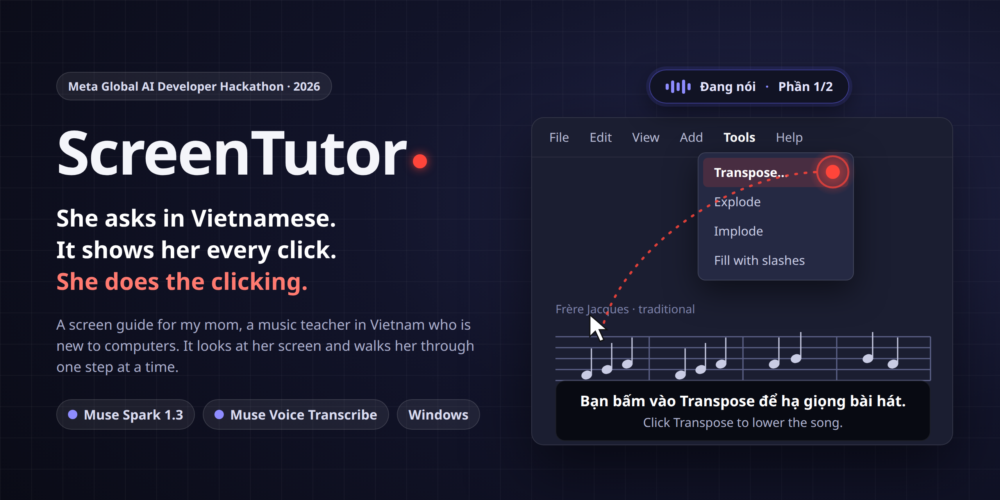

<p align="center"></p>

# ScreenTutor (tiếng Việt)

Tác tử nhiều bước trên Windows: nhìn màn hình, chỉ từng chỗ một, tự kiểm từng bước, để một cô giáo lớn tuổi mới dùng máy tính tự làm xong việc của mình. Nó không bao giờ bấm thay. Dự án thi Meta Global AI Developer Hackathon (hạn nộp 4/11/2026).

**Đã chạy trên Windows: T13 (03/11) và T15 (04/11)**, luật ghi trước khi chạy, kết quả trong `docs/tests/T15_WINDOWS.txt`. T15 đạt: màn hình đã đổi thì không nói (3/3 ca), dấu chấm đi theo chuột (4/4 luật), dừng khi bảo dừng (5/5). Nói và chỉ cùng lúc: 3/4 luật; luật còn lại trượt theo script đo, nhưng xem từng khung hình thì chấm đáp trong khoảng 0,15 s quanh tiếng (script làm cho vòng đỏ cũ). Trượt: link dạng chữ thường; đổi cỡ chữ cả bài (**Enter thừa sau Ctrl+A xoá trắng tài liệu rồi báo xong: chưa sửa, không dùng cho việc sửa cả bài**); bấm "Làm tiếp" thì tutor im (chưa rõ nguyên nhân). Mấy chữ đầu câu hỏi hay bị mất hoặc nghe sai.

Repo được xây theo từng thành phần. Mỗi thành phần được thử riêng trước khi ráp vào nhau.

| Thư mục | Thành phần | Trạng thái |
|---|---|---|
| `grounding_test/` | Phép thử "bấm vào đâu" với Muse Spark / Wonder. Kết quả: dùng Spark qua image understanding, `reasoning_effort` low; từ 02/11 app dùng `minimal` kèm stream (xem dòng T12) | Xong |
| `screentutor/state.py`, `winstate.py` | Bản tóm tắt trạng thái Windows gửi kèm ảnh: cửa sổ đang ở trước, các cửa sổ phía sau, app mặc định, thư mục chuẩn, file mới | T2b đạt trên Windows (`docs/tests/T2_STATE_SENSORS_WINDOWS.txt`) |
| `tts_eval/` | Giọng đọc tiếng Việt VieNeu-TTS v3 Turbo chạy local trên CPU: đo tốc độ, tạo mẫu nghe thử | Đã chốt giọng Hải Đăng, bản int8. T7 trên Windows: âm thanh đầu tiên 0,15 s, RTF 0,29 |
| `stt_eval/` | Nhận giọng bằng Muse Voice Transcribe (gửi file) | T3 đạt: 8/8 câu thật của mẹ còn ý (`docs/tests/T3_MOM_VOICE.txt`) |
| `screentutor/tutor.py`, `screen.py` | Một lượt tutor: ảnh màn hình + trạng thái + câu mẹ hỏi → chỗ cần chỉ, loại bước, câu nói, kế hoạch, ghi chú (Spark, effort minimal, stream). `tutor_eval/` là phép thử T4 trên 12 ca thật | T4 trước khi có việc lớn (02/11): trúng 11/12 và 12/12, trễ trung vị 4,91 s |
| T12 phần R5, R6 (`tutor_eval/run.py`) | Luật việc lớn có làm hỏng 12 ca thật không; luật ghi trong docstring | Lần đầu **trượt**: trễ 11,1 s. Lần cuối: trúng 11/12 và 11/12, 24/24 câu (có bộ lọc bằng code nhưng lần này không phải đổi câu nào), tổng 5,35 s, **vòng hiện sau 3,15 s**, ca link sau Zalo 5/5. Chưa độc lập: quy tắc trạng thái viết sau khi xem ca đó. 6 lần chạy, 1 lần huỷ vì lỗi DNS |
| `tutor_eval/big_task.py`, `fake_zalo.py` | Việc lớn trên màn hình Zalo giả, chữ bịa, Session và Spark thật. **Không phải T12** | Lần cuối **trượt luật kế hoạch 7/9** (cần 8/9); khung đọc 3/3, bảo kéo 9/9, câu nói 21/21 |
| `screentutor/island.py`, `conversation.py`, `ui.py`, `levels.py` | Dynamic island 12 trạng thái, hội thoại, thẻ kế hoạch tự mở, nút tròn, sóng âm | Xem trước đã được founder duyệt; chưa chạy trên Windows |
| `screentutor/overlay.py` (B3) | Khung đọc có làm tối, gợi ý kéo xuống, dấu tích sau khi kiểm bước, viền sáng khi đang xem | Như trên |
| `screentutor/gesture.py` | Đường chuột khi mẹ chỉ hay khoanh: tính trên máy, gửi một dòng toạ độ | Test trên đường giả; ngưỡng chưa đo trên tay thật |
| `screentutor/guards.py` | Tự lên tiếng khi Word mở bản tạm của Zalo, chỉ dùng tín hiệu trên máy | Bản giả đạt; Spark dẫn đúng 4/4 lần thăm dò; chữ thật trên thanh tiêu đề Word chưa biết |
| `screentutor/memory.py`, `history.py` | Lịch sử từng việc; kho kiến thức riêng: BM25 trên máy, hồ sơ, bộ lọc | T14: 9/10, 5/5, 20/20, 0,2 ms; A/B 5/5 so với 0/5 trên ca dựng. Kho không làm trả lời nhanh hơn |
| `session.py` (B7), `tutor_eval/resume.py` | Làm tiếp việc đang dở từ đúng phần đã dừng | 5/5 ở lần chạy thứ hai, trên màn hình giả |
| `screentutor/overlay.py` | Lớp phủ chỉ chỗ (PySide6): vòng đỏ rỗng bay từ con trỏ chuột tới đích rồi nhấp nháy, luôn nằm trên cùng, cú bấm và phím gõ đi xuyên qua; vòng vàng khi bấm sẽ gửi đi hoặc ghi đè | T5 trên Windows: vòng trùng đầu chuột 5/5, bấm và gõ xuyên qua được; Start menu vẫn che vòng. Vòng vàng chưa thử ở bước gửi hay ghi đè thật (T13) |
| `screentutor/inputs.py`, `still.py`, `session.py` | Bước 4: nghe click và phím giữ Ctrl+Alt (chỉ quan sát, không cài hook), chờ màn hình đứng yên, lượt kiểm bước (`Tutor.follow_up`), vòng lặp một phiên nhiều bước. `tutor_eval/steps.py` là phép thử T6a | T6a chạy lại đạt (02/11): bước đúng 24/24, việc xong đúng 22/24, trỏ 16/18, trễ trung vị 4,26 s. T6 trên Windows: nghe click đạt; chờ đứng yên 4/6, chưa đạt ngưỡng 5/6 (`docs/tests/T6_CLICK_STILL_WINDOWS.txt`) |
| `screentutor/speak.py`, `listen.py` | Bước 5: giọng đọc VieNeu int8 Hải Đăng (có sửa cách đọc tên file, "OK", giờ), nghe bằng Muse realtime (nút tròn: ENDPOINTING có ghép các đoạn cách nhau dưới 1 s; giữ Ctrl+Alt: PUSH_TO_TALK). `tutor_eval/voice.py` là phép thử T7a | T7a đạt (31/10): 8/8 câu của mẹ còn ý khi ghép trong 1 s (không ghép: 5/8). T7 trên Windows: giọng và micro đạt (`docs/tests/T7_VOICE_WINDOWS.txt`) |
| `screentutor/app.py` | Cả app: nút tròn hoặc giữ Ctrl+Alt → nghe → nhìn màn hình → vòng hay khung chỉ chỗ và giọng nói → chờ mẹ làm → kiểm bước → bước tiếp. `tutor_eval/e2e.py` là phép thử T8a và T8b (giọng thật của mẹ qua cả chuỗi) | T8 trên Windows, founder đóng vai mẹ: chạy trọn vòng, xuất PDF đủ 6 bước. T8b (02/11): 4 đoạn ghi âm × 2, trỏ trúng 8/8 (trước đó 4/8, sau khi thêm ghi chú về nút WPS nên không phải mẫu mới); ngừng nói → nghe tiếng tutor trung vị 7,5 s. Các bản sửa ngày 02/11 chờ thử trên Windows (`docs/tests/T13_WINDOWS.txt`) |
| `session.py`, `speak.py` (C1), `tutor_eval/voice_sync.py` | Vòng chỉ hiện cùng lúc với tiếng đầu tiên của câu, không hiện ngay khi model vừa biết chỗ. `voice_sync.py` đo độ lệch trên video quay màn hình có tiếng | Trước C1, trên 4 video T13: tiếng tới sau vòng trung vị 2,85 s (29 lượt), 26 lượt lệch quá 1 s, 2 lượt có vòng mà không có tiếng. Sau C1: chờ thử trên Windows (`docs/tests/T15_WINDOWS.txt`) |
| `fresh.py`, `session.py` (C2), `tutor_eval/stale_replay.py` | Ngay trước khi nói, so màn hình với ảnh vừa trả lời; đã đổi (thông báo tắt, hộp mới, mẹ tự làm trước) thì không nói, im lặng xem lại, tối đa 2 lần liền | Phát lại trên 4 video T13: bắt 5/5 lượt màn hình đã cũ, báo nhầm 1/24 (ngưỡng chọn trên chính các lượt này, chưa độc lập). Chờ thử trên Windows (T15 mục C) |
| `overlay.py` (C4: `Companion`, `dot_at`), `app.py` | Dấu chấm thay vòng đỏ: từ lúc mẹ hỏi tới lúc việc xong, chấm đứng cạnh mũi chuột và đi theo, thở khi tutor đang xem, bay theo đường cong tới chỗ chỉ đúng lúc tutor nói, bấm xong thì quay về. Tắt thoáng lúc chụp màn hình gửi model | Trên Ubuntu: chấm dời 60 px làm đổi 24 ô ảnh, dưới ngưỡng 41 ô của phần chờ màn hình đứng yên. CPU, nhấp nháy lúc chụp, chấm có lọt vào ảnh không: chờ T15 mục D |
| `tutor.py`, `session.py`, `inputs.py`, `textsnap.py`, `overlay.py` (K), `tutor_eval/actions.py` | Ý của founder trong T13: dạy cả kéo bôi đen, phím tắt (Ctrl+A/C/V/X/Z/L/T, Enter, Tab), gõ vào ô; link dạng chữ thường thì bôi đen, sao chép, dán vào trình duyệt; bước không làm màn hình đổi thì không bảo làm lại y hệt. App chỉ đọc 9 phím đó, không đọc chữ gõ. Hai đầu cú kéo được hít vào ranh giới chữ, đếm theo đoạn chữ model ghi | Trên ảnh thật T13, 8 ca × 5 lần: prompt cũ đạt 1/7 ca (bấm lại vào chữ thường 5/5 lần, đúng vòng lặp T13); prompt K đạt cả 8/8 ca, 39/40 lượt. 12 ca T4 vẫn đạt mọi luật R5 (trúng 11/11, tổng 6,18 s so với 6,16 s của prompt cũ chạy cùng lúc; vòng hiện chậm hơn 0,4 s). Chờ thử trên Windows (T15 mục E) |
| `tutor_eval/speed.py` (E1), `tutor_eval/hedge.py` (E2) | Ý "attention vào pixel đã đổi": ít pixel hơn hay ít suy nghĩ hơn có nhanh hơn không; hỏi hai lần cùng lúc lấy câu về trước | E1: ảnh thu nửa trượt 5/12 và còn chậm hơn; thời gian đi theo token suy nghĩ (319 ở minimal, 656 ở low, 1.834 khi không đặt). Giữ PNG đầy đủ, minimal. E2: gửi đôi lấy câu về trước làm vòng hiện sau 3,24 s thay vì 4,11 s (trung vị 36 lần), p90 4,94 s thay vì 6,08 s, trúng như cũ: đã bật, tốn gấp đôi lượt gọi |
| `app.py` (`Offers`), `tutor.py` (`aside`), `tutor_eval/aside.py` (W-6) | "Làm tiếp" trượt trong T13: câu phụ trả lời một lượt không bao giờ được mời; câu phụ có kế hoạch riêng bị coi là việc khác. Giờ câu phụ một lượt được mời; câu phụ có kế hoạch riêng thì hỏi model (chỉ có chữ, sau khi câu phụ xong) xem đó là bước chen ngang của việc lớn hay việc khác hẳn | Ba lượt, luật ghi trước mỗi lượt, không lượt nào đạt. Bản đang dùng (founder chọn bản chặt): việc khác đúng 45/45, chen ngang 30/35, nhưng ca thật D3 "tải file Excel trước" 0/5 (mẹ vẫn nói "làm tiếp" được); p90 5,13 s. Bản hỏi "có quay lại không" bắt hết chen ngang nhưng mời sai 13/50. Chờ thử trên Windows (T15 mục F) |
| `memory.py` (`asks_to_stop`), `app.py` (`stop_task`), `island.py` (dấu ×) | Tutor biết dừng khi mẹ bảo dừng: câu dừng ngắn ("dừng", "thôi không làm nữa", "để sau") được nhận trên máy, không gửi cho model; bấm × trên ô ghim lúc đang có việc cũng vậy. Việc bị xoá hẳn (file lịch sử, dòng "Việc trước", ghi chú trong kho kiến thức), không mời "Làm tiếp", tutor nói một câu ngắn. Nói "làm tiếp" mà không còn việc nào dở thì tutor nói "Không còn việc nào đang dở", không gọi model | Gửi cho model thì 6 lần: hỏi lại 3, chỉ vào nút đóng Zalo 1. Bộ nhận câu: 16 câu dừng đều nhận, 12 câu trông giống không nhận nhầm. Chờ T15 mục G |
| `tutor_eval/sam.py`, `segment.py` | Phép thử T11: SAM 3.1 vẽ viền ôm chỗ cần bấm. **Không nằm trong app** | T11 trượt (02/11): 15/21 viền đúng, ngưỡng 90%. Giữ vòng đỏ, bỏ SAM |

```bash
py -m screentutor.state --delay 6 --out t2_results\S-1         # trên Windows, chỉ cần Python
uv venv --python 3.12 tts_eval/.venv && uv pip install --python tts_eval/.venv/bin/python -r tts_eval/requirements.txt
cd tts_eval && .venv/bin/python bench.py speed                 # đo tốc độ fp32 và int8
.venv/bin/python -m stt_eval.transcribe --refs refs.tsv audio/*.m4a   # cần ffmpeg
.venv/bin/python -m tutor_eval.run run --yes                       # T4: 24 lần gọi, khoảng $0.15
py -m screentutor.tutor --live --delay 5 "Mẹ bấm vào đâu?"         # trên Windows: chụp, hỏi, lưu ảnh có đánh dấu
py -m screentutor.tutor --live --delay 5 --show 15 "Mẹ bấm vào đâu?"  # như trên, và hiện vòng chỉ chỗ 15 giây
py -m screentutor.overlay --follow-mouse                          # trên Windows: vòng có nằm đúng đầu chuột không
py -m screentutor.session --delay 6 "Mẹ muốn xuất giáo án ra PDF"  # trên Windows: cả phiên nhiều bước
py -m screentutor.app                                             # trên Windows: cả app
```

## Thành phần 1: phép thử grounding với model Meta (`grounding_test/`)

Phép thử này trả lời: model Meta có chỉ đúng chỗ cần bấm trên giao diện Windows không, theo quy ước toạ độ nào, và mất bao lâu, tốn bao nhiêu cho mỗi lần hỏi?

Script **chỉ gọi API và chấm điểm**. Nó không bấm chuột hay gõ phím trên máy nào.

| File | Vai trò |
|---|---|
| `config.py` | Endpoint, model, bảng giá, ngưỡng quyết định |
| `meta_api.py` | Hai cách hỏi. **M1:** computer use (Responses API, tool `computer`), chỉ đọc hành động đầu tiên. **M2:** image understanding, trả về JSON toạ độ |
| `scoring.py` | Chấm trúng / sát / trượt. Mỗi câu trả lời được chấm theo **cả hai quy ước**, pixel và thang 0–1000, vì docs Meta mâu thuẫn ở điểm này |
| `datasets.py` | Đọc ảnh hiệu chuẩn và 12 ca thật, chuẩn bị ảnh để gửi |
| `report.py` | Tổng hợp `calls.jsonl` thành `summary.md` |
| `run.py` | Dòng lệnh `check` / `plan` / `run` |
| `calibration/` | 2 ảnh tổng hợp có đáp án biết trước. Tạo lại bằng `tools/make_calibration.py` |
| `cases/cases.json` | Mô tả 12 ca thật và khung đúng. Ảnh `.png` của các ca **không commit**, vì repo công khai |

### Cài đặt

```bash
uv venv .venv && uv pip install --python .venv/bin/python -r requirements.txt
cp .env.example .env   # rồi điền MODEL_API_KEY
```

### Chạy

```bash
.venv/bin/python -m pytest -q                                         # kiểm tra logic chấm điểm, không gọi API
.venv/bin/python -m grounding_test.run check                          # key có hợp lệ không, model nào dùng được (không tốn tiền)
.venv/bin/python -m grounding_test.run plan --stage calibration       # xem trước sẽ gọi gì, ước tính chi phí
.venv/bin/python -m grounding_test.run run --stage calibration --yes  # bước 0: hiệu chuẩn
.venv/bin/python -m grounding_test.run run --stage cases --yes        # bước 1: 12 ca thật (spark/m1, spark/m2, wonder/m2)
.venv/bin/python -m grounding_test.run run --stage cases --models spark --methods m1 --effort low --yes  # bước 1: spark/m1 effort low
.venv/bin/python -m grounding_test.run run --stage cases --models spark --methods m1 --resize 1366x768 --yes
.venv/bin/python -m grounding_test.run run --stage cases --only case_01,case_06,case_09,case_11 --lang en --yes
```

Kết quả nằm ở `grounding_test/results/<thời điểm>-<giai đoạn>/`, gồm `summary.md`, `calls.jsonl` và `raw/`. Thư mục này không được commit.

### Quyền riêng tư

- Chỉ dùng model **Standard**. Không dùng bản Contributor, vì Meta được phép dùng nội dung gửi tới bản đó để huấn luyện.
- Ảnh chụp màn hình thật và phản hồi gốc của API chỉ lưu trên máy.
- Key nằm trong `.env`. File này đã được gitignore.

### Tài liệu gốc

Kế hoạch giấy, các ngưỡng quyết định và nhật ký thảo luận nằm trong ghi chú Obsidian của founder (`GROUNDING_TEST_PLAN.md`), không nằm trong repo này.
